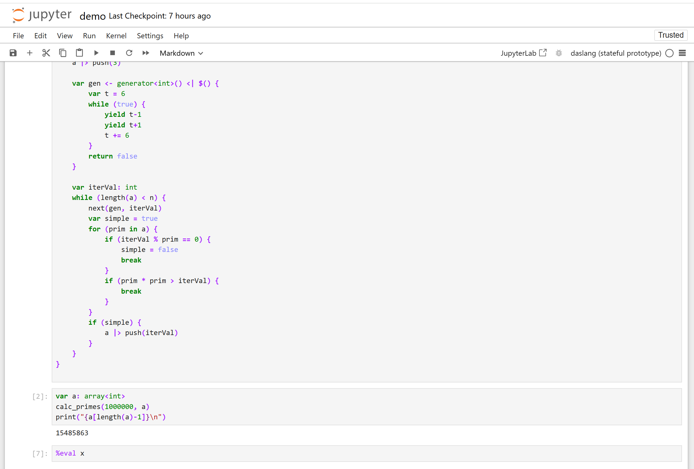

# daslang-jupyter

[](https://github.com/spiiin/jupyter_daslang_kernel/actions/workflows/build.yml)

**Experimental alpha.** Verified on Windows x64 / AVX2, Python 3.12 and
JupyterLab 4.2.5. [Install a paired release](RELEASE.md#install-a-release),
[build from source](RELEASE.md#build-from-source), or read the [changelog](CHANGELOG.md).

Kernel wheels require the runtime from the same build. GitHub release assets
include both; source users can build their own pair.

Experimental Jupyter kernel with a stateful execution engine.
The implementation uses Python's `ctypes`, the real daslang C ABI, and a small
C++ context adapter for exception traces;
it does not interpret daslang in Python or replay previous cells.



## Runtime

Windows x64, AVX2, Python 3.12, **pinned daslang commit**
`f916e0092ef38032dd81e8a55a231c3c4b4a5533`. The paths below show the
development checkout in `C:\src\daScript`; choose your own source or release
runtime directory. The DLL and standard library must come from the same build. `Runtime` accepts either a source tree (`bin/Release`) or SDK (`bin`).
Set `DAS_SDK` or pass `--sdk` to use another compatible SDK.

```powershell
cd C:\src\daslang-jupyter
python console.py --demo
python console.py
$env:DAS_SDK = "C:\src\daScript"
python -m unittest -v test_session
```

## Try it in Jupyter

```powershell
cd C:\src\daslang-jupyter
python -m pip install build setuptools wheel
python build_package.py --sdk C:\src\daScript
python -m pip install "dist/daslang_jupyter-0.11.0a1-py3-none-win_amd64.whl[lab]"
python -m daslang_jupyter install --sdk C:\src\daScript
python -m jupyterlab demo.ipynb
```

Select **daslang (stateful prototype)** as the notebook kernel, then run cells
with Shift+Enter. `demo.ipynb` demonstrates persistent variables, arrays,
mixed cells, inferred types, function redefinition, errors and recovery. `%eval expression` displays a
value; `%reset` discards state. `print()` output is sent to the notebook.
The runtime runs in a separate worker process. **Kernel -> Interrupt Kernel**
stops an active cell and restores the last completed checkpoint on the next
execution. Restarting the kernel clears the session.
The last expression displays automatically. A trailing semicolon suppresses it.
Assignments, declarations and void calls do not produce an extra result.
Expressions execute once; strings and containers use daslang's own formatting.
Imported script-module globals also survive recompilation and worker recovery.
Their init hooks run once per committed module lifetime; `%reset` runs finalize hooks.
`%eval` remains available for explicit evaluation.

The installer records the selected runtime/native DLL paths and current Python
executable. The kernel is launched as an installed module and does not depend on
the checkout location. Reinstall after moving the runtime or changing the Python
environment. Remove it with `python -m jupyter kernelspec remove daslang`.

Protocol smoke test (starts a temporary kernel, requires no installation):

```powershell
$env:DAS_SDK = "C:\src\daScript"
python -m unittest -v test_kernel
```

## Try Interrupt

Open `interrupt-demo.ipynb`. Run the first cell, then the infinite loop in the
second cell. Click the stop button or **Kernel -> Interrupt Kernel**, then run
the third cell: `x` should still equal `7`.

The kernelspec uses `interrupt_mode: message` so Windows Jupyter sends an
interrupt request over its control channel. After upgrading from the older
kernel, run `python install_kernel.py --sdk C:\src\daScript` and start a new
kernel (restart JupyterLab if its existing kernel manager cached the old spec).

Native stdout and stderr are published as UTF-8 chunks while the cell runs,
including output without a newline. Output already received by Jupyter remains
visible after Interrupt. Output still in flight at process termination cannot
be guaranteed. Stream messages are separate from checkpoint replies.

Interruption discards changes made by the unfinished cell. A recoverable
daslang `panic` keeps partial mutations as before; its reply includes a
checkpoint. A native crash yields `RuntimeProcessError`; the next cell starts
a worker and restores the preceding checkpoint. Initializers and previous
instructions and completed module initializers are not replayed. External file/network side effects cannot be
rolled back.

The worker watches the kernel process and exits if it dies, including during
an infinite loop. Checkpoints stay in the kernel's memory, not on disk.

For interactive use, finish each cell with a blank line:

```das
var x : int = 10
```

```das
x += 5
```

Use `:eval x` to display `15`, `:reset` to discard state, `:quit` to exit.
Declarations, function definitions and instructions can share a cell:

```das
var x = 10
var y = x * 2
def twice() : int { return x * 2 }
print("{y}; {twice()}\n")
```

### Build the current runtime

```powershell
cmake -S C:\src\daScript -B C:\src\daScript\build-jupyter -G "Visual Studio 17 2022" -A x64 "-DDAS_MODULES_INCLUDE=" -DDAS_TOOLS_DISABLED=ON -DDAS_TESTS_DISABLED=ON -DDAS_TUTORIAL_DISABLED=ON -DDAS_AOT_EXAMPLES_DISABLED=ON -DDAS_FLEX_BISON_DISABLED=ON
cmake --build C:\src\daScript\build-jupyter --config Release --target libDaScriptDyn --parallel 4 -- /nodeReuse:false
```

On MSVC 19.38, configure once more with
`-DCMAKE_PROJECT_INCLUDE=C:/src/daslang-jupyter/msvc-compat.cmake` before building.
This suppresses its C4706 warning in the compiler DLL without changing source.

No optional modules are needed for these tests. Rebuild after changing runtime
headers or standard-library sources; avoid mixing binaries and another tree's
standard library. The public alpha is tested only against the pinned commit below.

Build the notebook parser from that same source tree:

```powershell
cmake -S C:\src\daslang-jupyter\parser -B C:\src\daslang-jupyter\parser\build -G "Visual Studio 17 2022" -A x64 -DDAS_SOURCE=C:/src/daScript
cmake --build C:\src\daslang-jupyter\parser\build --config Release --parallel 4 -- /nodeReuse:false
```

The parser DLL bundles upstream Tree-sitter and the generated daslang grammar;
no Python Tree-sitter package is needed. `DAS_PARSER` can override its location.

Build the context adapter after the matching runtime:

```powershell
cmake -S C:\src\daslang-jupyter\native -B C:\src\daslang-jupyter\native\build -G "Visual Studio 17 2022" -A x64 -DDAS_SOURCE=C:/src/daScript
cmake --build C:\src\daslang-jupyter\native\build --config Release --parallel 4 -- /nodeReuse:false
```

It uses the current Release runtime headers and import library. Reconfigure and
rebuild it after rebuilding daslang. A runtime DLL hash guards accidental binary
mismatches before initialization. `DAS_RUNTIME_BRIDGE` overrides its DLL path.

The context captures the native stack before `try/recover` unwinds it. Error
locations and native frames are mapped to original cell lines, including old
definitions restored from checkpoints. Inlining and fastcall are disabled for
these notebook programs to preserve useful frames; this favors diagnostics over
maximum call performance. Native crashes still require worker recovery and do
not provide a daslang exception stack.

For definition syntax rejected by Tree-sitter, a compiler-only diagnostic pass
reports the actual daslang error. It never simulates or executes that rejected
definition. A compiler-accepted but unsupported parser construct is reported
explicitly as a notebook parser limitation.

## Execution model

Each request generates a fresh program containing persistent, typed globals,
current function overloads and require directives, generated Archive save/load functions, and one
entry point for the current cell. Globals have no user initializer in the
generated program: their initializer is run in the cell entry point instead.
The official Tree-sitter grammar identifies function definitions and outermost
variable declarations. Nested declarations remain local. Missing explicit types
are resolved by the daslang compiler using `typedecl(initializer) -const -&`;
RTTI gives the concrete type that subsequent requests keep. Type queries do not
execute initializers. Initializers and other statements run in source order.
Compilation succeeds before existing values are serialized. Values are copied
as archive bytes into the new context and deserialized into its own heaps.
The old context is released only after restoration succeeds. After execution,
the worker sends typed declarations, current function sources and base64
Archive blobs to the Jupyter process. A reply is accepted after this checkpoint
arrives. The parent retains it while a subsequent request executes.

Compilation failure leaves the previous program, definitions, and values intact.
Recoverable runtime exceptions preserve declarations and mutations performed
before the exception. The cell entry point catches them with daslang's
`try/recover`, allowing subsequent requests to execute. External side effects
are not rolled back. Native crashes terminate the worker; the Jupyter process
survives and retains the preceding checkpoint.

Re-executing a typed declaration with an initializer assigns the value again.
Changing a variable's type is rejected. Re-executing a declaration with no
initializer preserves its existing value. Function definitions are keyed by their parameter signature; plain structs remain keyed by name.

## Scope of this prototype

- Persistent globals: numbers, booleans, strings, plain structs, and nested
  arrays/tables of those value types. Table keys remain scalar. Archive support
  is compiler-checked for each declaration.
- Explicit or inferred variable types; multiple declarations and instructions
  in one cell. Use one name per declaration; no persistent destructuring yet.
- Function and struct definitions, require directives and executable code can share a cell. Function overloads are tracked by parameter signature.
- Statement cells may contain ordinary blocks and local variables, which do
  not become persistent notebook globals.
- One Runtime per worker process, operated and disposed on its main thread.
  The console still embeds it directly. State is not persisted across kernel restart.
- No arbitrary pointers, shared object identity, closures, resource handles,
  generators or automatic schema migration. Persistent references,
  declaration annotations and inferred types outside the supported value-type
  subset are rejected. Some uncommon language constructs may exceed the
  Tree-sitter grammar; the daslang compiler validates every generated program.
  Lifecycle `[init]`/`[finalize]` hooks in notebook definitions remain rejected.
  Imported module hooks are managed explicitly at module initialization/session close.
- Minimal Jupyter adapter uses ipykernel. Native output is captured through
  Windows UCRT pipes and published during execution. A bounded reply queue
  provides backpressure; incremental UTF-8 decoding preserves split characters.
- Compiler diagnostics for user code identify `In[N], line M` and show the
  original source line. Function origins survive checkpoints and restoration.
  Column markers are omitted because generated code can change columns.
  Errors in generated helpers or library files retain compiler locations;
  runtime exceptions include captured native frames and their original lines.
- Interrupt kills the active worker; a subsequent request restores the last
  completed state. Unsupported external resources cannot be restored this way.
- Every request recompiles and serializes the current state, including `:eval`.
  This validates correctness before optimizing performance.

## Structs and nested containers

Structs and nested containers are supported. A struct has one explicitly typed
name per field and no defaults, methods, inheritance, annotations, pointers or
recursive dependencies. Initialize fields in executable cell instructions.

```das
struct Stats {
    count : int
    values : array<int>
}
var stats : Stats
stats.count = 5
stats.values |> push(7)
stats
```

The next cell can modify `stats`. Arrays of structs, nested structs,
`array<array<int>>` and `table<string;array<int>>` also survive checkpoints.
Constructors support inference, such as `var p = Point(x=3, y=4)`.

An unchanged schema can be re-executed without losing values. Changing a schema
used by a variable (including nested dependencies) is rejected before compilation.
Use `%reset` and redefine it to discard old values. Unused schemas may change.
Runtime type hashes additionally guard Archive restoration before any bytes load.
Checkpoints own their schema metadata and survive closing the original session.
`structs-demo.ipynb` demonstrates these cases.

## Editor support

Editor protocol handlers are implemented: `complete_request`, `inspect_request`
and `is_complete_request`. They read committed session metadata and parse text;
they do not start a worker, compile code, execute functions or deserialize values.

Completion includes session variables, functions, struct types/fields, nested
field paths and array/table element fields. Typed variables in the current cell
and visible block scopes are also considered. There is a small built-in help
catalog and keyword/magic completion; this is not full standard-library or LSP
completion. Unexecuted inferred variables may have unknown types. Strings and
comments suppress suggestions, except expression regions inside interpolation.

Inspection shows source signatures, variable/field types, struct fields, `//!`
documentation and definition cell origins. It does not read variable values.
Incomplete checks recognize unfinished blocks, parentheses, strings, comments,
type arguments, trailing operators and missing bodies, and suggest indentation.
Completeness means syntax supported by this kernel, not semantic correctness.

In JupyterLab use **Tab** after a prefix (`stats.co`) for completion. For help,
use **Shift+Tab** at a function call or enable the completion documentation panel.
See the official [completer documentation](https://jupyterlab.readthedocs.io/en/stable/user/completer.html)
and [code console documentation](https://jupyterlab.readthedocs.io/en/latest/user/code_console.html).
Notebook cells still execute with Shift+Enter; whether incomplete code continues
input automatically depends on the frontend (notably consoles).
`editor-demo.ipynb` contains a setup cell and manual completion/inspection probes.

## Next steps

1. Add broader standard-library/language-server integration.
2. Extend schema support and explicit migrations.
3. Measure large-session performance.
4. Add rich output.

The choice of Jupyter transport is independent of this session engine. An
ipykernel wrapper avoids a separate C++ build for the first kernel; a native
xeus implementation remains an option once the session semantics are stable.

## Portable Python package (Windows x64)

The wheel includes the parser and context adapter DLLs. The daslang runtime and
standard library remain external: use the exact compatible build. This version
was tested against master commit `f916e0092ef38032dd81e8a55a231c3c4b4a5533`.
The adapter fingerprints the runtime DLL and rejects a different build. Rebuild
the wheel after rebuilding the runtime. The native binaries require Windows x64,
AVX2 and the matching Microsoft Visual C++ runtime; Python 3.12 or later is needed.

For a new machine, clone the daslang source, check out the tested commit, build
`libDaScriptDyn` using the recipe above (CMake and VS 2022 C++ tools), then build
the wheel with `python build_package.py --sdk <source-tree>`. Paths shown above
are examples: pass the actual source location. Build dependencies: `build`,
`setuptools>=75`, `wheel>=0.44`; Python runtime dependencies are in pyproject.toml.
The checkout and build configuration must match the runtime headers and binaries.
Optional modules are disabled in the tested runtime build.

Install the resulting wheel into the environment that will run the kernel:

```powershell
python -m pip install "<wheel-path>[lab]"
python -m daslang_jupyter check --sdk <daslang-tree>
python -m daslang_jupyter install --sdk <daslang-tree>
python -m jupyterlab
```

`check` tests native loading, binary compatibility, compilation and transfer of a
persistent variable between two cells. `install` runs the same check before
writing the kernelspec. By default installation is per-user; `--sys-prefix`
installs into the active environment, and `--prefix PATH` chooses another prefix.
`--name NAME` permits a second kernelspec. `DAS_SDK` supplies the runtime when
`--sdk` is omitted. `--parser`/`--bridge` or their environment variables override
bundled native DLLs; their absolute paths are saved in the kernelspec.

The console script `daslang-jupyter` is equivalent to `python -m daslang_jupyter`.
For development, build the native DLLs first, then use `python -m pip install -e .`.
The legacy `install_kernel.py` forwards to the installed package.
Distribution uses [GitHub releases](https://github.com/spiiin/jupyter_daslang_kernel/releases) or locally built wheels. There is no PyPI release yet.

Packaging uses the documented [setuptools configuration](https://setuptools.pypa.io/en/latest/userguide/pyproject_config.html)
and [package data](https://setuptools.pypa.io/en/stable/userguide/datafiles.html)
mechanisms, with custom filtering for the existing flat checkout and a Windows
wheel tag because the package contains DLLs.

## Syntax highlighting in JupyterLab

The separate prebuilt frontend package `jupyterlab-daslang` registers daslang in
JupyterLab 4.2–4.x. It highlights notebook cells selected through kernel metadata
and `.das` files, with theme-aware types, keywords, functions, fields, numbers,
strings/interpolation, nested comments, operators and `%eval`/`%reset`.
Install its wheel into the environment running the **JupyterLab server**:

```powershell
python -m pip install C:\src\daslang-jupyter\labextension\dist\jupyterlab_daslang-0.1.0-py3-none-any.whl
python -m jupyterlab C:\src\daslang-jupyter\highlighting-demo.ipynb
```

Restart an already running server and reload the browser page after installation.
The frontend wheel needs no Node.js or JupyterLab rebuild. The kernel wheel and
frontend wheel are separate; kernel execution/completion does not depend on the
frontend package. For source builds and scope see `labextension/README.md`.
Six tokenizer/CodeMirror tests and browser checks passed on JupyterLab 4.2.5:
notebook cells, `.das` automatic selection, and light/dark theme type coloring.
The implementation uses JupyterLab's documented
[language registry](https://jupyterlab.readthedocs.io/en/stable/api/interfaces/codemirror.IEditorLanguageRegistry.html).

## let, overloads and require (0.9)

Top-level `let` bindings persist alongside `var`. The generated program keeps a
real const global so normal assignments, field writes and mutable calls are
checked by the daslang compiler. Internal initialization and Archive helpers
remove const solely to initialize/restore the value. Inferred and explicit types,
copy/move/clone initializers, plain structs and supported containers work.
An initializer runs only when that declaration cell executes. Re-executing `let`
with an initializer updates its saved value once; without an initializer it
preserves the value. Switching a name between `let` and `var` requires `%reset`.
The same existing persistent value-type restrictions apply; references, closures
and persistent generators are still unsupported. A `let` is a runtime readonly
notebook value, not a promise of compile-time evaluation of its initializer.

Functions may have several overloads in one or several cells. Adding/replacing
one parameter signature preserves the others. Keys use normalized parameter type
syntax/mutability and arity, excluding parameter names, defaults and return types;
grouped parameters and generic auto aliases are normalized. Semantic equivalence
between different type-alias spellings is still left to the compiler. Inspection
shows all stored overloads, their docs and their original cell locations;
completion offers the function name once.

Top-level `require` directives are retained and deduplicated with their aliases
and origins. They survive compilation failures, checkpoints and Interrupt,
and `%reset` clears them. Imports apply to the whole compilation unit, regardless
of their position among cell statements. For standard libraries:

```das
require math as m
require daslib/strings_boost as sb
let root = m::sqrt(9.0)
let words <- sb::split("a,b", ",")
```

For local files use an explicit relative path, for example
`require ./utilities.das as util`, relative to the kernel working directory
(normally the notebook directory). Module files and the runtime/library tree must
remain available when a worker restores a checkpoint. Module source changes are
seen during later compilations; module contents are not embedded in checkpoints.
Errors in module bodies retain their native file locations.

Script modules containing functions and compile-time constants are supported.
Since 0.10, used module-private globals and lifecycle hooks are supported; see below.
Non-checkpointable resource types are rejected before initialization. Source-module
state uses RTTI and a native value codec alongside notebook Archive checkpoints. Imported custom structs are not yet added to the persistent
schema registry. Availability of native modules depends on the selected runtime
build. Macro/compile-time processing remains part of daslang compilation.

`language-features-demo.ipynb` demonstrates let initialization once, native
readonly errors, require aliases, overload dispatch and individual redefinition.
After upgrading the Python package, restart the notebook kernel to load the new version.
Rebuild the native adapter as well when running directly from source.

## Module state and lifecycle (0.10)

Private and public runtime globals of imported `.das` modules survive subsequent
cells and worker recovery. Module-private plain structs, nested arrays/tables,
strings, scalars, enum values and fixed-size arrays are supported. Identity is
module name + canonical source path + variable name; the loader does not require
`@live` annotations or edits to the source files. Checkpoints are still in memory.

Simulation builds code and type metadata with initialization deferred. Existing
notebook and module values are restored into the new context before new global
initializers run. Module `[init]` hooks follow the runtime's own sorted order and
run once after the first successful import. Ordinary recompilation and Interrupt
recovery do not run them again. New globals initialize once when first used.
Inactive module values remain in the checkpoint so a later use does not lose them.

`[finalize]` hooks run on `%reset` and graceful idle worker shutdown, not when an
intermediate compiled context is discarded. Graceful worker shutdown has a bounded
timeout; Interrupt, crash, hard process termination and a stuck finalizer cannot
guarantee cleanup. Restarting the whole kernel clears its in-memory checkpoint.
Recoverable cell panic keeps partial mutations, including module values.
Module-init failure leaves the previous committed session intact. External effects
of interrupted or failed initialization cannot be rolled back.

The native codec copies values into the new context's own heaps; it does not copy
pointers to the old context. Structural fingerprints include nested field names,
offsets/types, fixed dimensions and enum definitions; incompatible layouts are
rejected before a blob loads. Pointers, references, classes/resources, closures,
iterators and shared-memory globals remain outside this value checkpoint model.
Native C++ module external state is not captured by this mechanism.

User source modules are freshly compiled with `ignore_shared_modules`, as in the
live host, so `module shared` does not hide source edits. Builtin/SDK-only programs
keep the existing cache. This favors correctness for user-module notebooks;
AST/module caching is a later performance improvement. Changing an initializer
or init hook does not rerun it for an already initialized module; `%reset` starts
a new lifetime. Module files must remain available when restoring a worker.

The current compiler folds a bare global reference in a global initializer to its
source default, even when the referenced global is mutable. The notebook file-access
adapter wraps such user-module copy initializers in an internal `never_inline`
getter, preserving runtime reads after restoration. This happens in memory with
original line numbers; source files on disk are unchanged. Inference and copying
still use the compiler's normal rules.

`module-state-demo.ipynb` and `examples/notebook_counter.das` demonstrate a private
counter, arrays/tables, init once and finalize on reset.

### Relation to daslang-live

The implementation was compared with `utils/daslang-live/main.cpp` and
`modules/dasLiveHost/live/live_vars.das` at the tested runtime commit. Live's `@live`
pass generates Archive before/after-reload helpers, skips constant let bindings,
and discards a saved value when its initializer hash changes. The live host
simulates fresh contexts and calls its lifecycle again on reload. Those semantics
differ from notebook cells and rollback to the last committed checkpoint.

The kernel therefore does not enable the `daslang-live` application loop,
`live_host`, `@live` or its resource-specific reload agents. It reuses the runtime's
context/type metadata and the live host's fresh-module compilation policy, with
notebook-owned checkpoint and lifecycle management. Resource-aware serializers
would be a separate extension of the supported state model.

## License

See [LICENSE](LICENSE) for project code and [third-party notices](THIRD_PARTY_NOTICES.md) for bundled components.

## Macro modules written in notebook cells (0.11)

A daslang macro must be defined in a separate module from its use. Ordinary
`require ./notebook_macros.das` compiles that module using the native compiler.
The kernel now supports creating/editing it directly in a cell:

```das
%%writefile notebook_macros.das
options gen2
module notebook_macros public
require daslib/ast
require daslib/ast_boost
require daslib/templates_boost
require daslib/macro_boost
require daslib/ast_verify

[call_macro(name="plus_one")]
class PlusOneMacro : AstCallMacro {
    def override visit(prog:ProgramPtr; mod:Module?; var expr:ExprCallMacro?):ExpressionPtr {
        macro_verify(length(expr.arguments)==1, prog, expr.at, "plus_one expects one argument")
        var result <- qmacro($e(clone_expression(expr.arguments[0])) + 1)
        verify_expression(result)
        return <- result
    }
}
```

Then execute a separate ordinary cell:

```das
require ./notebook_macros.das
var value = 40
plus_one(value) // 41
```

`%%writefile [-a] PATH` saves the remaining cell exactly as UTF-8 text. Quote
paths containing spaces; Windows backslashes are preserved. Missing parent
folders are created. Overwrite uses a temporary file and atomic replacement;
`-a` appends. The cell body is not compiled/executed and session values are not
changed. It works before runtime initialization and can repair a broken module
before worker checkpoint restoration. Relative paths use the kernel's working
folder, normally the notebook directory.

Re-execute the file cell after changing a macro, then execute a normal cell to
compile with the updated source. The existing fresh-user-module policy also
refreshes `module shared`. Compiler errors leave the preceding committed session
intact; repair the file and run another cell. Macro bodies execute at compilation
time and may run multiple times during inference/recompilation. Macro-time
registries are not notebook globals or checkpointed values. File changes are
external side effects: Interrupt and `%reset` do not undo them. Required files
must remain available for checkpoint recovery.

This adds file creation/editing, not a second macro interpreter. Annotation,
call and other macros supported by the selected compiler can live in `.das`
modules. Their emitted notebook code still has to fit the kernel's supported
persistent-value and Tree-sitter syntax subset; imported macro names are not yet
included in semantic completion. Direct macro-class definitions inside ordinary
notebook cells are not supported. `macro-cells-demo.ipynb` and
`examples/notebook_macros.das` contain the tested call-macro example.
